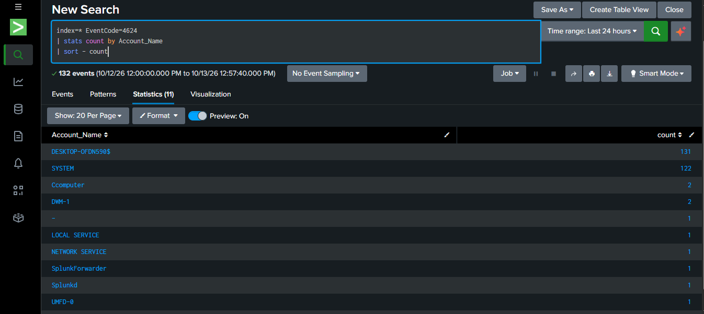

# Suspicious Login Activity Detection Using Splunk

## Project Overview
This beginner-level SOC Analyst project investigates Windows successful and failed login events using Splunk.

## Objective
To review Windows login activity and identify events that may require further investigation.

## Tools Used
- Splunk
- Windows Security Logs
- Windows Event Viewer

## Event IDs
- **4624:** Successful logon
- **4625:** Failed logon

## Splunk Queries

### 1. Count successful logins by account
```spl
index=* EventCode=4624
| stats count by Account_Name
| sort - count
```

### 2. Review successful login details
```spl
index=* EventCode=4624
| table _time Account_Name Logon_Type
| sort - _time
```

### 3. Search failed logins
```spl
index=* EventCode=4625
| stats count by Account_Name
| sort - count
```

## Investigation Findings

- Reviewed successful login events (Event ID 4624).
- Reviewed failed login events (Event ID 4625).
- Compared successful and failed login counts using Splunk.
- Failed logins alone do not confirm an attack.

## Conclusion

This project demonstrates basic SOC Analyst L1 investigation skills using Splunk.

## Disclaimer
This project is for educational purposes. Account details and other sensitive information should be sanitized before publishing.
## Evidence


